<div align="center">

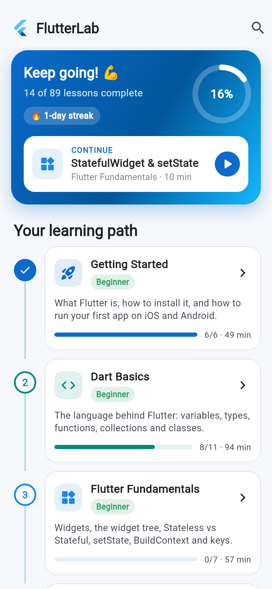

# FlutterLab

**Learn Flutter from zero to advanced, inside a Flutter app.**

An interactive mobile course with 89 lessons, runnable Dart examples, 59 live widget playgrounds,
quizzes, coding challenges and progress tracking. Works fully offline on iOS and Android.


</div>

---

## Screenshots

<table>
  <tr>
    <td align="center"><br><sub><b>Learning path</b></sub></td>
    <td align="center">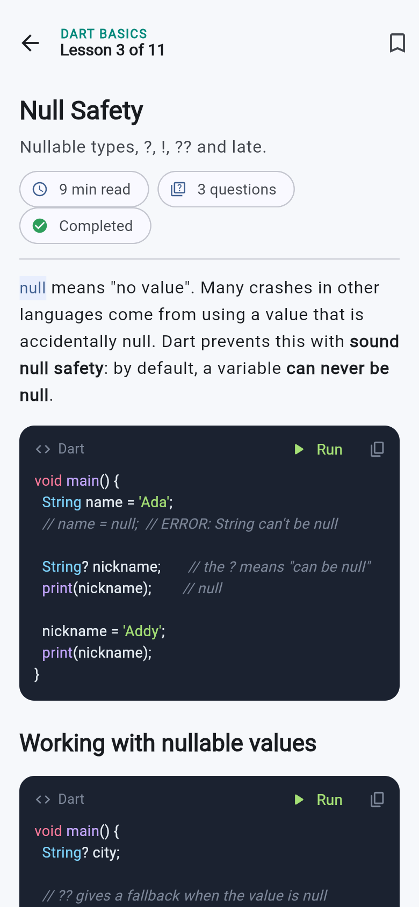<br><sub><b>Lessons</b></sub></td>
    <td align="center">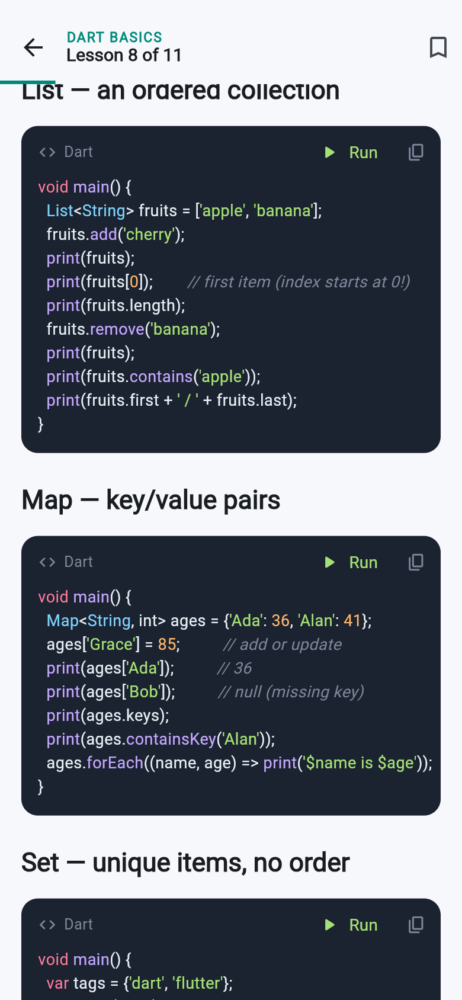<br><sub><b>Runnable Dart code</b></sub></td>
    <td align="center">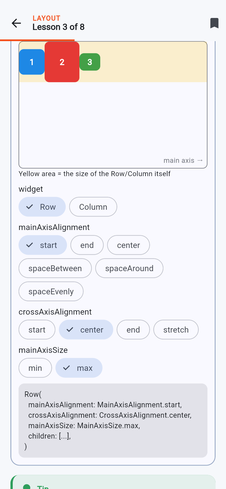<br><sub><b>Live widget playgrounds</b></sub></td>
  </tr>
  <tr>
    <td align="center">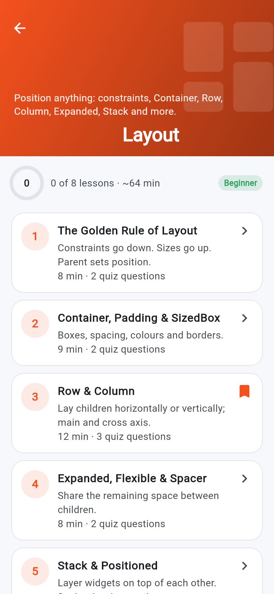<br><sub><b>Modules</b></sub></td>
    <td align="center">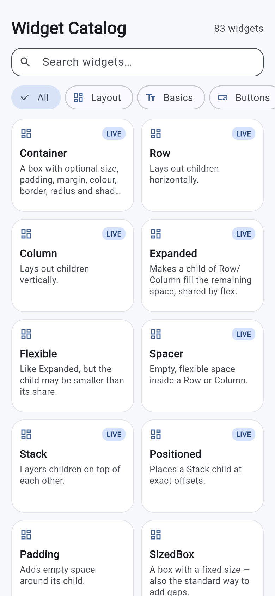<br><sub><b>Widget catalog</b></sub></td>
    <td align="center">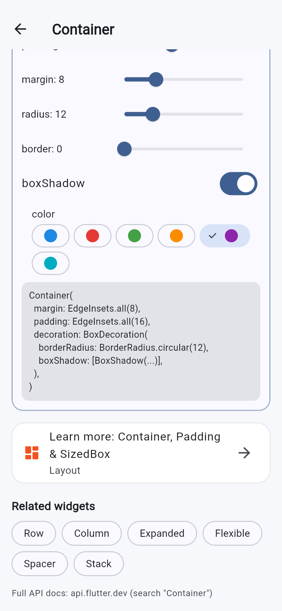<br><sub><b>Interactive widget docs</b></sub></td>
    <td align="center">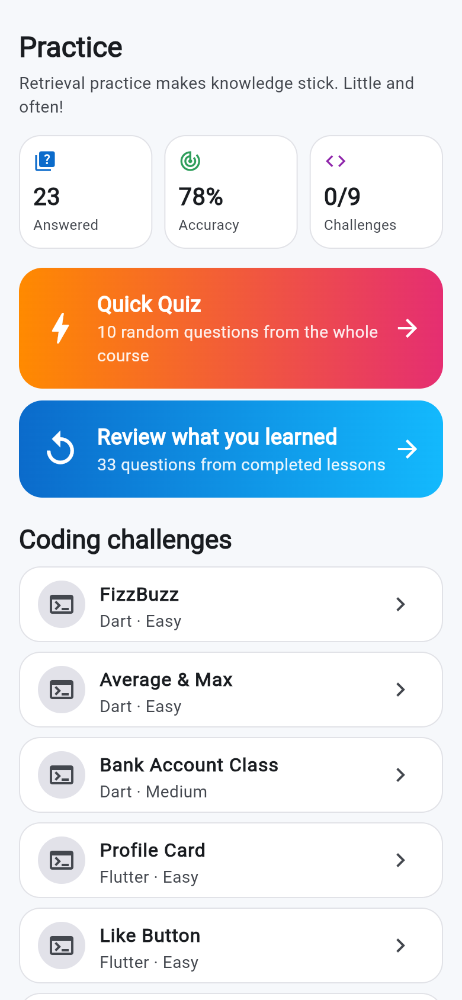<br><sub><b>Practice &amp; quizzes</b></sub></td>
  </tr>
  <tr>
    <td align="center">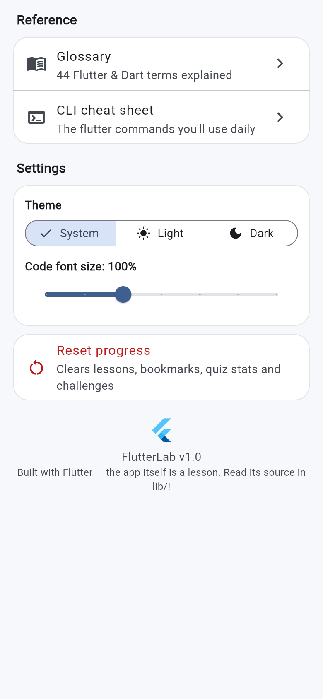<br><sub><b>Settings &amp; reference</b></sub></td>
    <td align="center">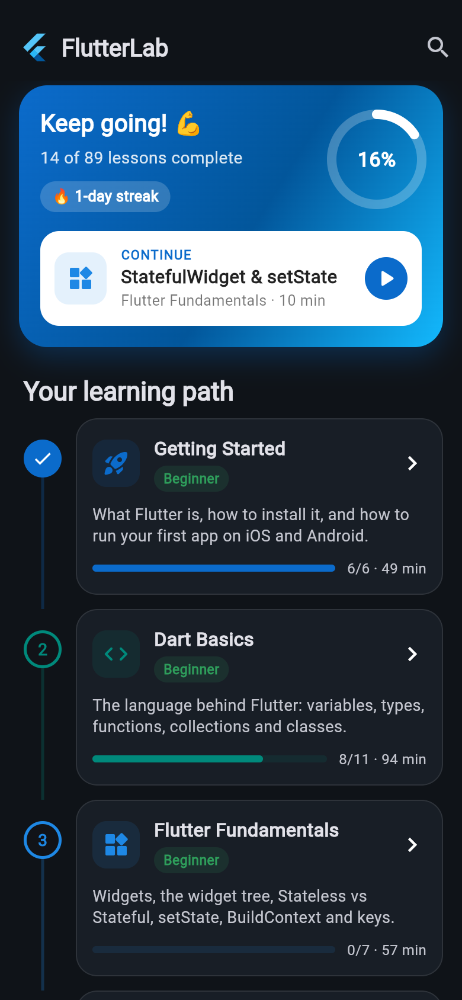<br><sub><b>Dark mode</b></sub></td>
    <td align="center">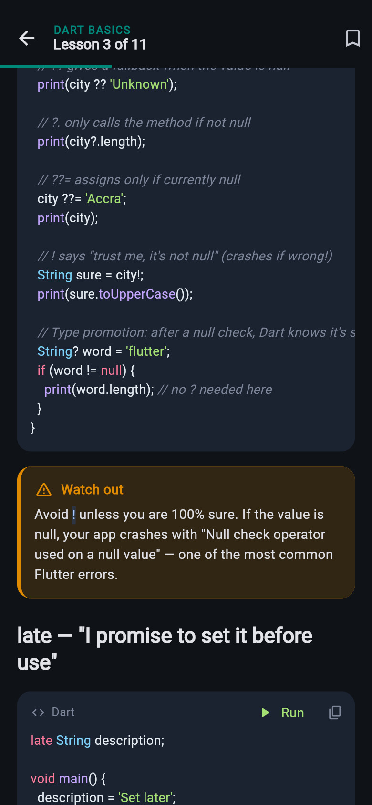<br><sub><b>Dark mode lesson</b></sub></td>
    <td></td>
  </tr>
</table>

## Features

| | |
|---|---|
| 📚 **89 lessons in 15 modules** | From installing Flutter to releasing on the App Store and Google Play |
| ▶️ **Runnable Dart examples** | Tap **Run** on a code block to execute real Dart and see the output in the app |
| 🧪 **59 live widget playgrounds** | Change Row/Column alignment, drag sliders on a Container, swap widgets with and without keys, watch the widget lifecycle happen |
| 🧩 **Widget catalog** | 80+ widgets, searchable by name and category, each with code, a live demo and a link to its lesson |
| ✅ **Quizzes everywhere** | A quiz after every lesson with explanations, plus quick quizzes and quizzes by module |
| 💻 **Coding challenges** | 9 challenges with step-by-step hints and full solutions |
| 📈 **Progress tracking** | Completed lessons, daily streak, quiz accuracy and bookmarks, saved on the device |
| ☁️ **Google sign-in and cloud sync** | Optional: sign in with Google to sync progress between iPhone and Android (Firebase Auth + Firestore) |
| 🌗 **Light, dark and system themes** | Adjustable code font size |
| 📖 **Glossary and CLI cheat sheet** | 44 terms explained, plus the `flutter` commands you'll use every day |
| ✈️ **Works offline** | All content is bundled with the app |

## What you'll learn

| # | Module | Level |
|---|---|---|
| 1 | Getting Started: installing Flutter, iOS and Android setup, Hot Reload | Beginner |
| 2 | Dart Basics: variables, null safety, functions, collections, classes, OOP | Beginner |
| 3 | Flutter Fundamentals: widgets, Stateless vs Stateful, lifecycle, BuildContext, keys | Beginner |
| 4 | Layout: constraints, Row and Column, Expanded, Stack, fixing overflow | Beginner |
| 5 | Common Widgets: text, images, buttons, cards, chips, progress | Beginner |
| 6 | Input & Forms: TextField, validation, pickers, gestures | Intermediate |
| 7 | Lists & Scrolling: ListView.builder, GridView, slivers, PageView | Beginner |
| 8 | Navigation: Navigator, passing data, go_router, tabs, dialogs | Intermediate |
| 9 | Styling & Theming: ThemeData, dark mode, decoration, responsive design | Intermediate |
| 10 | Dart: Next Level: async/await, streams, generics, records and patterns | Intermediate |
| 11 | State Management: lifting state, InheritedWidget, ChangeNotifier, Provider, Riverpod, Bloc | Intermediate |
| 12 | Async, Data & Networking: FutureBuilder, HTTP, JSON, local storage | Intermediate |
| 13 | Animations: implicit, explicit, Hero, AnimatedList | Intermediate |
| 14 | Advanced Flutter: CustomPaint, platform channels, testing, performance, architecture, Firebase, release | Advanced |
| 15 | Capstone: build a Todo app step by step | Advanced |

## Tech highlights

- **The app teaches the patterns it's built with.** Progress state is a `ChangeNotifier` shared through an `InheritedNotifier`, and lesson sections are a `sealed` class rendered with Dart 3 pattern matching.
- **A small Dart "runner":** runnable examples are real Dart functions whose `print` is redirected to an in-app console, so output always matches the code shown.
- **A dependency-free syntax highlighter** for Dart code blocks.
- **Offline-first cloud sync:** the device stays the main copy. Changes are sent to Firestore as small updates (`arrayUnion`, `arrayRemove`, `increment`), so progress from two phones merges instead of overwriting, even when made offline. Firestore security rules ensure each user can access only their own data.
- **Firebase is optional at runtime.** If it can't start, the app runs exactly the same, offline.
- **Layout-audit tests** render every lesson, widget page and screen on a small phone (360 pt wide) in light and dark mode, at normal and large text sizes, with real fonts, and fail on any overflow.

## Project structure

```text
lib/
├── main.dart              # App entry: loads progress, starts optional Firebase sync
├── models/                # Lesson, Module, Section (sealed), QuizQuestion
├── data/
│   ├── curriculum.dart    # Module order + lookups
│   ├── modules/           # Lesson content (m00–m13)
│   ├── catalog.dart       # Widget catalog entries
│   └── practice.dart      # Challenges, glossary, CLI cheat sheet
├── demos/                 # 59 live widget playgrounds + the Dart example runner
├── state/app_state.dart   # Progress, streak, bookmarks, settings (ChangeNotifier)
├── sync/sync_service.dart # Google sign-in + Firestore two-way sync
└── ui/                    # Screens: learn, lesson, catalog, practice, me
test/
├── widget_test.dart        # Content integrity + every demo builds + app flows
├── layout_audit_test.dart  # Every screen, small phone, light/dark, large text
└── sync_test.dart          # Sync hooks and merge rules
firestore.rules             # Each user can only read and write their own document
```

## Getting started

**Requirements:** the Flutter SDK (stable), plus Xcode for iOS and/or Android Studio for Android.

```bash
git clone https://github.com/tejHacks/flutter_lab-mobile-app.git
cd flutter_lab-mobile-app
flutter pub get
flutter run            # choose an iPhone simulator, Android emulator or phone
```

Run the tests:

```bash
flutter test
```

Build for release:

```bash
flutter build apk --release --split-per-abi   # Android
flutter build ipa                             # iOS (needs an Apple Developer account)
```

### Firebase (optional)

Google sign-in and cloud sync use the Firebase project configured in `lib/firebase_options.dart`. Firebase client keys are **public identifiers**, not secrets; data is protected by Firebase Auth and the rules in `firestore.rules`. To use **your own** Firebase project:

1. Create a project at [console.firebase.google.com](https://console.firebase.google.com) and enable **Authentication → Google** and **Firestore**.
2. Run `flutterfire configure`, or register the iOS and Android apps and replace `lib/firebase_options.dart`, `ios/Runner/GoogleService-Info.plist` and `android/app/google-services.json`.
3. Deploy the security rules: `firebase deploy --only firestore:rules`.

## Roadmap

- [ ] Publish on TestFlight and Google Play
- [ ] More capstone projects (weather app, notes app)
- [ ] Lesson audio and text-to-speech
- [ ] Localisation (French, Yoruba, Hausa, Igbo)

## Author

**Olateju Olamide Emmanuel**: mobile developer (Flutter · Swift · Laravel)

- GitHub: [@tejHacks](https://github.com/tejHacks)

If FlutterLab helped you learn, please ⭐ the repo!
